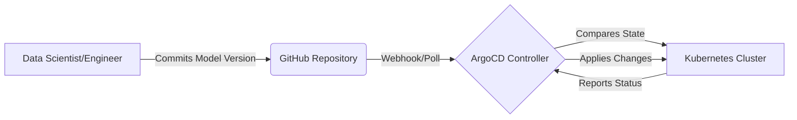
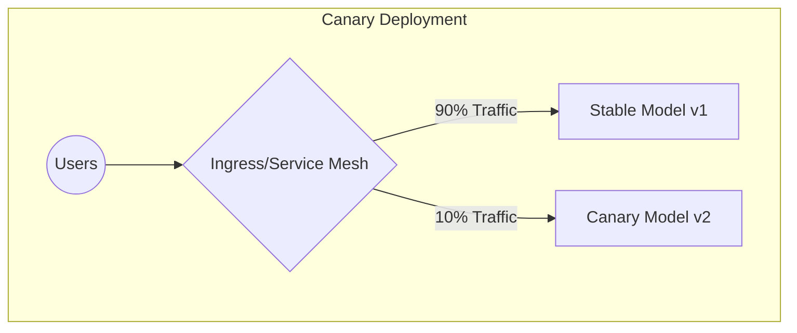

# Argo and Advanced Deployment Strategies

**Session Time:** 120 minutes

---

## Table of Contents
1. ArgoCD's Role in Continuous Delivery and GitOps
2. Implementing Staged Rollouts (Blue-Green & Canary)
3. Automated Rollback and Version Control Strategies
4. Lab: Canary Deployment Simulation
5. Wrap-Up and Reflection
6. Resources

---

## Learning Objectives

By the end of this module, participants will be able to:

1. **Describe** ArgoCD’s role in continuous delivery and GitOps workflows. 
2. **Implement** staged rollouts such as blue-green and canary deployments.
3. **Evaluate** the effectiveness of automated rollback and version control strategies.

---

## Session Breakdown

| Segment | Topic                                   | Duration (minutes) |
|---------|-----------------------------------------|--------------------|
| 1       | GitOps Philosophy & ArgoCD Core         | 20                 |
| 2       | Advanced Rollouts: Blue-Green & Canary  | 20                 |
| 3       | Version Control and Automated Rollbacks | 20                 |
| 4       | Lab: Canary Deployment Simulation       | 60                 |


---

## 1. ArgoCD's Role in Continuous Delivery and GitOps

In traditional Continuous Delivery (CD), a CI server "pushes" updates into the production environment. 
> In **GitOps**, the paradigm shifts: Git becomes the single source of truth for your infrastructure and applications. **ArgoCD** is a declarative, GitOps continuous delivery tool for Kubernetes that "pulls" these configurations.

For AI Systems Engineering, this means your model endpoints, environment variables, and resource limits are completely version-controlled. If the cluster goes down, you can rebuild it entirely from the Git repository.

### Tools: GitHub & GitOps, ArgoCD
* **GitHub (GitOps):** 
  
  Stores declarative Kubernetes manifests (YAML files).

* **ArgoCD:** 
  
  Runs inside your Kubernetes cluster, continuously monitoring the GitHub repository. If the cluster state deviates from the Git state, ArgoCD detects it as "Out of Sync" and automatically corrects it.



**Practical Example:**
A professional managing an AI inference API updates the model image tag in GitHub from `fraud-model:v1` to `fraud-model:v2`. ArgoCD detects this commit and automatically updates the Kubernetes deployment to match, without requiring a manual `kubectl apply` command.

---

## 2. Implementing Staged Rollouts (Blue-Green & Canary)

Updating an AI model in production carries high risk. A new model might have high accuracy in offline testing but suffer from severe latency in the real world. Advanced rollout strategies mitigate this risk by controlling the exposure of new updates.

### Staged Rollout Concepts

* **Blue-Green Deployment:** Two identical environments exist (Blue is live, Green is idle). The new model is deployed to Green, tested, and then the load balancer instantly switches 100% of traffic to Green.
* **Canary Deployment:** The new model is rolled out to a small subset of users (e.g., 5%). If metrics (latency, error rate, prediction confidence) remain stable, traffic is gradually increased.

### Tool: ArgoCD (with Argo Rollouts)

Argo Rollouts is a Kubernetes controller and set of CRDs (Custom Resource Definitions) that provide advanced deployment capabilities on top of ArgoCD.



**Practical Example (Canary):**
You are deploying a new NLP summarization model. You configure an Argo Rollout to route 10% of traffic to the new container. To actually split traffic, Argo Rollouts requires `canaryService` and `stableService` references (or an ingress/service mesh integration).

```yaml
apiVersion: argoproj.io/v1alpha1
kind: Rollout
metadata:
  name: nlp-summarizer
spec:
  replicas: 5
  strategy:
    canary:
      canaryService: nlp-canary-svc # Required for traffic splitting
      stableService: nlp-stable-svc # Required for traffic splitting
      steps:
      - setWeight: 10
      - pause: {duration: 30s} # Shortened for demonstration purposes
      - setWeight: 50
      - pause: {duration: 30s}
```

Argo will send 10% of traffic to the new model, wait for you to observe system responses, and then scale to 50% if no alerts trigger. By catching issues during this early canary phase, automated rollbacks limit error budget consumption to a small window rather than impacting the full deployment.

---

## 3. Automated Rollback and Version Control Strategies

When a deployment fails—whether due to an Out-of-Memory (OOM) error or degraded model performance—speed of recovery is critical. Relying on manual intervention damages your service's reliability and error budget. 

### The Two Phases of Rollback: Abort vs. Revert
It is crucial to understand that rolling back involves two distinct operations at different layers:
1. **Argo Rollouts Automatic Abort:** This is a runtime safety mechanism. If the canary fails its health checks, the system automatically aborts the rollout, scales the canary pods to zero, and routes 100% of traffic back to the stable version instantly.
2. **Git Revert:** The permanent fix. Because Git is the source of truth, you must create a new commit (a `git revert`) that changes the image tag back to the stable version in your repository to ensure Git and the cluster remain in sync.

### Tool: AnalysisTemplates for Automated Health Checks
How does Argo know when to trigger that automatic abort? It uses an `AnalysisTemplate`. An AnalysisTemplate defines health-check metrics (like Prometheus queries), success conditions, and failure limits. 

**Practical Example:**
During the 10% Canary phase of a new recommendation engine, your Rollout YAML references an AnalysisTemplate that queries Prometheus for three metrics: latency, error rate, and confidence score. (Monitoring prediction confidence is an AI-specific metric not typically found in traditional SRE pipelines!)

1. The automated Argo Rollout analysis fails because the PromQL `successCondition` for error rate was breached.
2. The controller executes the Automatic Abort.
3. 100% of traffic is routed back to the stable version instantly.
4. The GitOps pipeline marks the deployment as "Degraded," alerting the engineering team to investigate safely offline.

---

## 4. Lab: Canary Deployment Simulation

**Objective:** Test a small rollout using ArgoCD and observe system responses. Learners gain confidence deploying updates safely and implementing rollback strategies.


> [!NOTE]
>
> [Lab: **Canary Deployment Simulation**](https://git.generalassemb.ly/ai-systems-engineering-reliability/lab-9-canary-deployment-simulation)
> 
> **Note**: Please refer to the dedicated [Lab Guide](https://git.generalassemb.ly/ai-systems-engineering-reliability/lab-9-canary-deployment-simulation)
 for full instructions, architectural constraints, and deliverables.
---

## 5. Wrap-Up and Reflection

**Reflection Questions:**

1. Why is the "Pull" model of GitOps (ArgoCD) generally considered more secure than the "Push" model of traditional CI/CD pipelines when managing AI infrastructure?
2. In a scenario where an AI model update introduces a subtle data drift issue rather than a hard crash, how might a Canary deployment save your company's reputation compared to a Blue-Green deployment?
3. What metrics would you configure to automatically trigger a rollback during a Canary deployment of a machine learning model?

---

## 6. Resources

* **GitOps Principles:** [OpenGitOps Foundation](https://opengitops.dev/)
* **ArgoCD Documentation:** [ArgoCD Getting Started](https://argo-cd.readthedocs.io/en/stable/)
* **Advanced Rollouts:** [Argo Rollouts Architecture](https://argoproj.github.io/argo-rollouts/)
