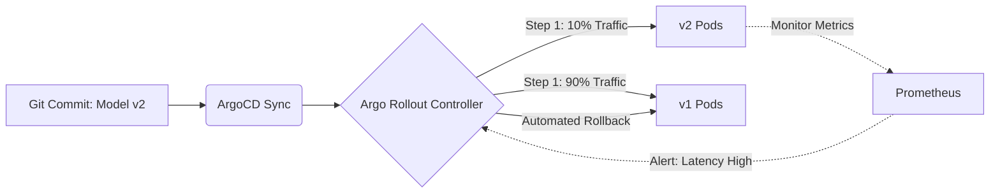

# Instructor Guide: Argo and Advanced Deployment Strategies

## Module Overview
This module transitions mid-career professionals from basic Kubernetes deployments to advanced, production-grade GitOps workflows. Students will implement deployment automation with ArgoCD and advanced rollout strategies. The primary focus is gaining hands-on experience managing versioned deployments, blue-green rollouts, and canary testing to safely release AI models. 

## Learning Objectives
By the end of this session, students will be able to:
* Describe ArgoCD’s role in continuous delivery and GitOps workflows.
* Implement staged rollouts such as blue-green and canary deployments.
* Evaluate the effectiveness of automated rollback and version control strategies.

## Session Pacing Guide (120 Minutes total)

| Duration   | Segment                               | Instructor Action                                                                                                                                                                   |
|:-----------|:--------------------------------------|:------------------------------------------------------------------------------------------------------------------------------------------------------------------------------------|
| **20 min** | **GitOps & ArgoCD Basics**            | Explain the "Pull" vs "Push" model. Show the ArgoCD UI and explain how it monitors a GitHub repository.                                                                             |
| **40 min** | **Staged Rollouts (Live Demo)**       | Demonstrate a Canary deployment. Update a model version in Git, watch ArgoCD sync, and show traffic splitting using Argo Rollouts.                                                  |
| **60 min** | **Lab: Canary Deployment Simulation** | Facilitate the lab where learners test a small rollout using ArgoCD and observe system responses. Guide them through deploying updates safely and implementing rollback strategies. |

---

## Delivery Notes & Teaching Tips

### 1. The GitOps Paradigm Shift
* **The "Source of Truth" Analogy:** Emphasize that in GitOps, if someone manually uses `kubectl edit` to change a production model's memory limit, ArgoCD will immediately overwrite it back to what is in GitHub. Git is the absolute law.
* **Mid-Career Context:** For professionals used to Jenkins pushing changes directly to servers, the "Pull" mechanism of ArgoCD running *inside* the cluster requires a mental shift. Emphasize the security benefits (CI server doesn't need cluster admin credentials).

### 2. Visualizing Rollout Strategies

Draw or display the difference clearly:
* **Blue/Green:** Switch is flipped immediately. Requires 2x the infrastructure temporarily.
* **Canary:** Slowly turns the dial. Safer for AI models where performance degradation (e.g., latency, weird predictions) is more common than a hard crash.

---

## Common Student Issues & Solutions

| Issue                                       | Potential Cause                                                                                         | Solution                                                                                                                                                 |
|---------------------------------------------|---------------------------------------------------------------------------------------------------------|----------------------------------------------------------------------------------------------------------------------------------------------------------|
| **ArgoCD shows "Out of Sync" constantly**   | A Kubernetes admission controller (like a mutating webhook) is changing the YAML after Argo applies it. | Teach students how to use `ignoreDifferences` in the ArgoCD Application manifest to ignore specific fields.                                              |
| **Canary Rollout is "Paused" indefinitely** | The Rollout YAML includes a `pause: {}` without a duration, waiting for manual promotion.               | Show students how to use the Argo Rollouts kubectl plugin to run `kubectl argo rollouts promote [name]`.                                                 |
| **GitHub Repo Connection Failed**           | The repository is private and ArgoCD lacks the correct SSH key or Personal Access Token.                | Guide students through adding the repository credential in the ArgoCD UI under Settings > Repositories.                                                  |
| **Rollback didn't revert the code**         | Students confused Kubernetes rollback with Git rollback.                                                | Clarify that while Argo Rollouts can abort a canary, the permanent fix requires a `git revert` in the repository to maintain the GitOps source of truth. |

---

## Debrief Questions

1. "In an AI environment, why might a Canary deployment be safer than a Blue-Green deployment when releasing a new Large Language Model (LLM) fine-tune?"
2. "If your Kubernetes cluster is completely destroyed, how long would it take to restore your AI applications using GitOps and ArgoCD compared to manual deployment scripts?"
3. "How does ArgoCD's self-healing feature prevent configuration drift caused by manual human intervention?"

---

## Resources for the Instructor

* **Reference:** 
  * [ArgoCD Core Concepts](https://www.google.com/search?q=https://argo-cd.readthedocs.io/en/stable/core_concepts/)
  * [Argo Rollouts - Canary Strategy](https://argoproj.github.io/argo-rollouts/features/canary/)
* **AI Prompt Bank:**
  * *"Generate an ArgoCD Application YAML that points to a GitHub repository containing Kubernetes manifests."*
  * *"Explain the difference between a Deployment and an Argo Rollout object to a mid-level DevOps engineer."*
